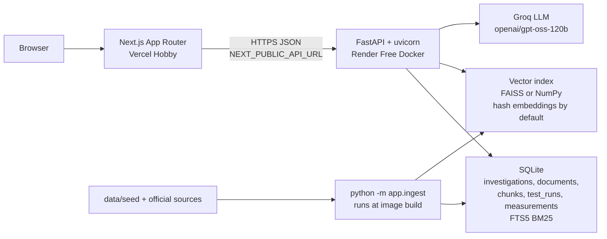
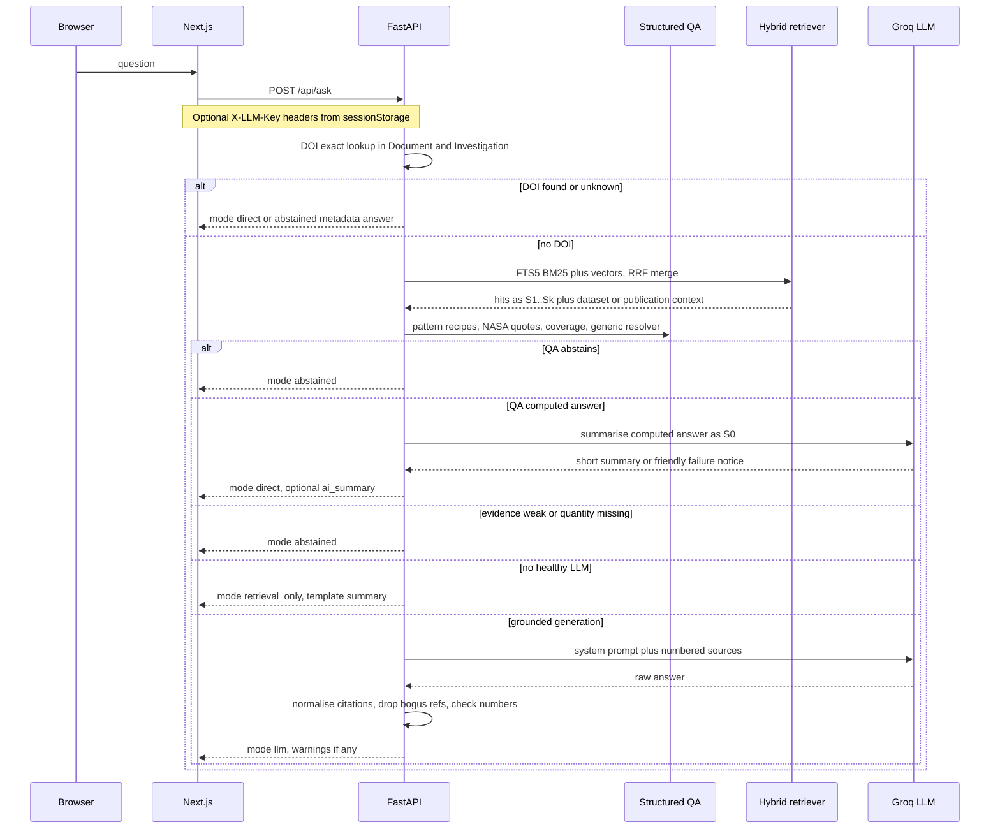
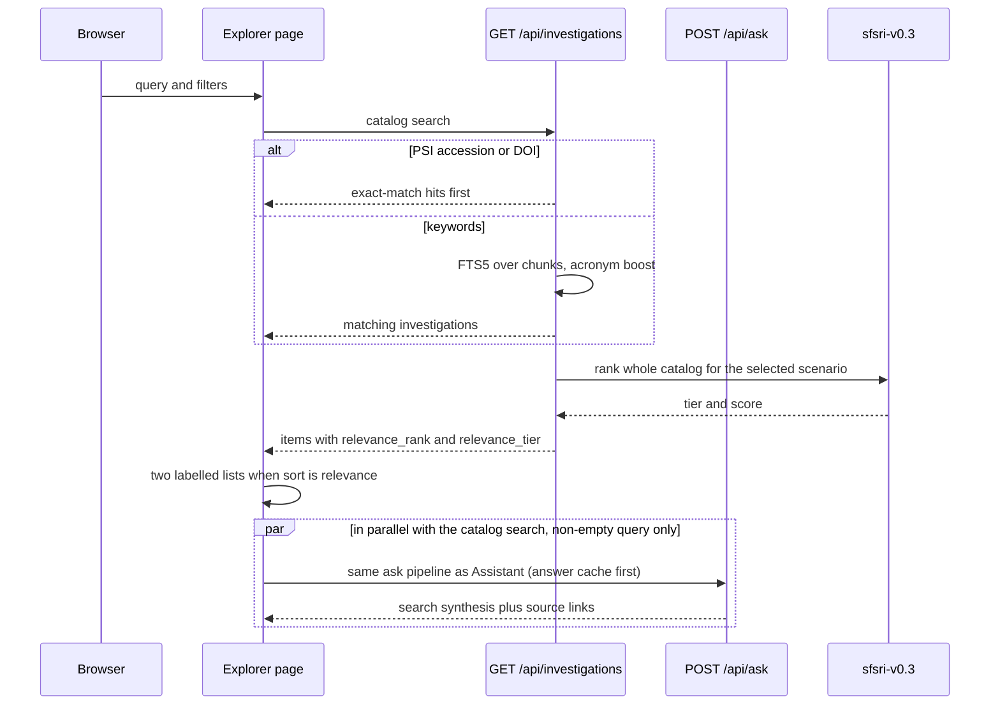

# DESIGN.md — High-level architecture

Flame in Freefall: SI-Powered Fire Safety Insights from Microgravity Combustion Data  
2026 NASA Space Apps Challenge · independent participant project (not affiliated with or endorsed by NASA)

This document describes how the running app is put together. Every statement is grounded in the current code and config. For local setup commands, see [README.md](README.md). For the investigation-page AI overview in more detail, see [docs/AI_OVERVIEW.md](docs/AI_OVERVIEW.md). [docs/ARCHITECTURE.md](docs/ARCHITECTURE.md) is a one-page summary of this file (the 10 November 2026 first draft it replaced is in git history).

---

## 1. Purpose and scope

The app is a research-discovery dashboard over NASA Physical Sciences Informatics (PSI) combustion investigations. It answers “has work already been done for these parameters?” (fuel/material, oxygen, pressure, airflow, gravity regime, hardware, measurement type), and lets a researcher inspect, compare, rank by research relevance, and ask evidence-grounded questions.

It is decision support only — not a certified fire-risk calculator, materials qualification system, or spacecraft safety authority. Ranking is research relevance, never a hazard score. PSI has no partial-gravity combustion data; microgravity results are not lunar or Martian performance.

**Scope rule.** The app answers only from the challenge Resources tab, the challenge Details/brief page, and references those resources name or link to (PSI records and their publications/DOIs, documents cited in the fact sheets or the Researcher's Guide, pages linked from the incident and spinoff pages). The official guidance-video transcript is included and labelled as a user-supplied challenge guide (YouTube auto-captions, cited by `[mm:ss]`). Outside facts are not used. For referenced papers, only public metadata, abstracts or open-access text are indexed (no paywall bypass); otherwise the app links out. When the corpus cannot answer, the assistant abstains.

Every indexed item carries a `provenance` field (`resource`, `reference` with its parent resource, or `user_supplied_guide`), enforced by `apps/api/tests/test_provenance.py`. Saved copies and SHA-256 checksums are in `data/sources/official/MANIFEST.md`.

**Corpus (as loaded at ingest).** 24 PSI Combustion Science records (19 microgravity + 5 ground/modeling) and all of their experimental tables; 8 NASA fact sheets and the Researcher's Guide, chunked per page; the challenge brief; Apollo 1, Apollo 13 and Mir pages; 3 spinoff pages; the NASA Combustion Science page and its linked FM2 / SoFIE / FLARE pages; the guidance-video transcript. Raw PSI zip and video archives are listed as metadata and linked out; they are not hosted or ingested (`LINK_ONLY` in `apps/api/app/ingest/official_sources.py`).

---

## 2. System overview

The repo is a monorepo. The browser talks only to the Next.js app, which calls the FastAPI API over HTTPS. The API owns the database, indexes, structured QA, retrieval, ranking, and LLM calls.



Locally the same shape applies, with the API at `http://localhost:8000` and the web app at `http://localhost:3000` (`CORS_ORIGINS`). Docker Compose can start both, optionally with an Ollama profile for a local LLM.

---

## 3. Components

### 3.1 Web app (`apps/web`)

Next.js App Router + TypeScript (`output: "standalone"`). Pages are client components that call the API through `lib/api.ts` (`cache: "no-store"`). Visitor-facing fetch errors are mapped in `friendlyError` so raw HTTP status text never appears.

| Route | Screen |
| --- | --- |
| `/` | Home: lead lunar coverage teaser, catalog stats, search box (goes to Explorer), top ranked investigations |
| `/androflame` | Intro / product story (`/intro` is an alias) |
| `/explorer` | Catalog search, filters, scenario ranking in two labelled tiers, search synthesis, compare picks |
| `/coverage` | “Has it been done?” parameter coverage form |
| `/compare` | Side-by-side comparison of 2–3 investigations |
| `/insights` | Scenario ranking with score breakdown |
| `/investigations/[id]` | Investigation detail, optional AI overview (`?from_q=` or `?q=` from Explorer) |
| `/assistant` | Ask the evidence |
| `/earth` | Documented vs inferred Earth links; explainer quotes |
| `/spacefire` | Spacecraft fire-safety timeline (quotes from official pages) |
| `/beyond-psi` | Experiments and facilities the official resources name that have no PSI Combustion Science record |
| `/lunar` | Lead lunar O2/pressure demo (chart, same-row matches). Still served; not in the current nav |
| `/settings` | Bring-your-own Groq key (sessionStorage) and admin AI / ingest controls |

The nav (`components/Nav.tsx`) groups the research tools under a menu: Explorer, Coverage, Compare, Insights, Earth, SpaceFire, Beyond PSI. AndroFlame, Assistant and Settings are top-level.

### 3.2 API (`apps/api`)

FastAPI app in `app/main.py` (title “Flame in Freefall API”, version `0.1.0`). Routes live under `/api` in `app/routers/api.py`. BYOK key headers are accepted only on the two AI endpoints, `POST /api/ask` and `GET /api/investigations/{id}/overview`, and refused everywhere else. At startup a background thread warms the in-process caches (section 7.1). Unhandled exceptions return `{"detail": "Internal error (details withheld)."}`.

| Method | Path | Role |
| --- | --- | --- |
| `GET` | `/` | Name, docs and health links |
| `GET` | `/api/health` | Liveness: `{ok, investigations, ai, answer_cache, notices}` (`answer_cache` = entries, hits, misses) |
| `GET` | `/api/stats` | Catalog counts from the seed and the live database |
| `GET` | `/api/meta` | Filter vocabularies, lenses, scenarios, reference atmospheres, counts |
| `GET` | `/api/investigations` | Catalog search and filters; optional scenario ranks and pagination |
| `GET` | `/api/investigations/{id}` | Full investigation record |
| `GET` | `/api/investigations/{id}/overview` | AI / computed overview, optionally scoped to `q` (calls the ask service with `investigation_ids`). Accepts BYOK headers; server-key results cached |
| `POST` | `/api/ask` | Assistant and Explorer search synthesis (structured QA + hybrid retrieval + optional LLM). Accepts BYOK headers; server-key results cached |
| `GET` | `/api/ask/quota` | Remaining server-key AI answers; does not consume quota |
| `POST` | `/api/qa` | Structured QA only (no retrieval, no LLM) |
| `POST` | `/api/coverage` | Parameter coverage (“has this been done?”) |
| `GET` | `/api/rank` | Deterministic scenario ranking (`sfsri-v0.3`) |
| `POST` | `/api/compare` | Compare 2–3 investigations |
| `GET` | `/api/lunar/points` | Countable rows with known O2 and pressure, for the lunar chart |
| `GET` | `/api/earth` | Earth / spinoff panel |
| `GET` | `/api/explainer` | Official-resource explainer quotes |
| `GET` | `/api/nasa/other-experiments` | Named programmes with no PSI Combustion Science record |
| `GET` | `/api/settings/ai` | Provider, index and limit status (no secrets) |
| `PUT` | `/api/settings/ai` | Switch providers in memory (admin token) |
| `POST` | `/api/ingest/rebuild` | Reload seed and rebuild indexes (admin token) |
| `GET` | `/api/export.csv` | CSV of selected investigations |
| `GET` | `/api/export/modeling.csv` | Every countable table row, SI-normalised, with verbatim cells and flags |
| `GET` | `/api/export/dictionary` | Column dictionary for the modeling export |

Ranking and coverage never call an LLM. They are pure functions of the database, so their results are memoised per loaded catalog (section 7.1).

### 3.3 Data model

SQLAlchemy models in `app/models.py`. Default store is SQLite at `data/db/flame.sqlite` (`DATABASE_URL` may be a Postgres URL). Numeric conditions live on `TestRun`, not on `Investigation`. Unknown values are `NULL` and never pass a filter. Every numeric field keeps verbatim source text. Flags are stored and shown; values are never silently corrected.

| Table | What it holds |
| --- | --- |
| `investigations` | One PSI campaign: accession, acronym, title, family, fuel class, hardware, gravity regime, platform, DOI, topics, measurement types, lenses, provenance, file lists |
| `documents` | PSI records, experimental-table files, publications (title/authors/DOI only), official PDFs/HTML, the brief, the guidance video |
| `chunks` | Searchable passages: text, section, locator (`p. 26`, `CSV record 12`, `[05:54]`), `source_url`, `source_type`, `verification_status`, provenance, optional `embedding_id` |
| `test_runs` | One experimental-table row: `row_kind` (`test`, `session`, `test_matrix`, plus notes / pre-test / continuation, which are kept but not counted), material, O2 / pressure / airflow min–max, diluents, flags, raw cells |
| `measurements` | Parsed numeric variables on a test run (often empty for a given quantity) |
| `chunks_fts` | SQLite FTS5 virtual table over chunk text (BM25) |

Data completeness on a catalog card is the share of ten fields that are filled: objective, approach, hardware, presence of test runs, any material, known O2, known pressure, known airflow, measurement types, documents (`serialize.completeness`).

### 3.4 Ingest pipeline

Two steps, both idempotent.

1. **Build seed** (offline, when sources change): `make seed` → `python -m app.ingest.build_seed`. Reads `data/sources/psi/` (record JSON + experimental-table CSV), the challenge brief, and curator rules, and writes versioned `data/seed/investigations.v2.json` and `challenge_brief_chunks.v2.json`.
2. **Load and index** (when the API Docker image is built, and via `make ingest` or `POST /api/ingest/rebuild`): `python -m app.ingest` (`app/ingest/load.py`). Drops and recreates tables, loads the seed, chunks PSI metadata / table summaries / each table row, loads official documents and the guidance-video transcript from `official_sources.py`, adds NASA programme excerpts (verbatim, verified against stored files), rebuilds FTS5, and embeds every chunk into `data/index` (FAISS or NumPy). Chunk size is about 900 characters with 150-character overlap.

The Docker image runs `python -m app.ingest` at build time (build arg `AI_EMBEDDING_PROVIDER`, default `hash`), so the database and vector index ship inside the image. The start command is:

```text
python -m app.ingest --if-needed && exec uvicorn app.main:app --host 0.0.0.0 --port ${PORT:-8000}
```

`--if-needed` skips the load when the baked database has investigations and the index signature matches the runtime embedder; otherwise it rebuilds from the seed in the image, as every boot did before. Loading (at build, at boot, or through the admin rebuild) also clears the in-process catalog snapshot and answer cache. `data/db/` and `data/index/` are gitignored.

The scope registry is the combination of `official_sources.py`, provenance on every row, `app/qa/scope.py` (abstention rules with cited justifications), and `test_provenance.py`.

---

## 4. Request flows

### 4.1 Ask / Assistant

`POST /api/ask` (and the Explorer search synthesis, which posts the same endpoint) runs `app/services/ask.py`. The investigation overview uses the same service with `investigation_ids=[id]` and `k=8`.



Details that the diagram compresses:

- **DOI lookup** (`_doi_answer`). A DOI in the question is an exact, case-insensitive match against `Document.doi` and `Investigation.doi`. The answer lists which PSI records name that paper or dataset DOI. Only title, authors, year and DOI are indexed; the app does not claim paper findings. An unknown DOI abstains.
- **Hybrid retrieval** (`app/retrieval/hybrid.py`). Lexical FTS5 (top 40) and, if the vector index signature matches the active embedder, a vector search (top 40) are merged with reciprocal-rank fusion (`RRF_K = 60`). A small score boost applies when an investigation acronym appears in the question. Results can be restricted to named investigation ids. Instruction-like lines in source text are sanitised before they go into the prompt.
- **Structured QA** (`app/qa`). `scope_check` abstains for certification, partial-gravity measurements, rockets/propellants, platforms PSI never lists, and programmes the resources name that have no PSI record. Otherwise pattern recipes, NASA-programme quotes, a threshold-coverage intent, and a generic one-investigation resolver run in that order. Numbers are computed from stored rows at answer time; quotes must exist in the corpus.
- **Abstention / weak evidence.** If QA does not apply, retrieval is treated as weak when there are no hits, or term coverage is under 0.5 and best vector similarity is under 0.45 and no investigation is named. A question that asks for a numeric quantity with no structured measurements (for example flame spread rate) also abstains.
- **Grounding prompt.** The model may use only the numbered sources, must cite `[S#]` on every factual sentence, must copy numbers exactly, and must write `INSUFFICIENT_EVIDENCE` only when no source is relevant. Temperature is 0. After the call the API strips leaked `<think>` blocks, normalises fullwidth brackets (`【S1】` → `[S1]`), expands grouped refs, removes citations that were not retrieved, and warns about uncited statements, numbers that appear in no source excerpt, and truncated output.
- **Fallback.** If the LLM is down, times out, or is over quota, the visitor still gets the computed or retrieved answer plus a plain-language notice. Failed provider calls are refunded and do not count against site limits.

Response `mode` values: `direct`, `llm`, `retrieval_only`, `abstained`.

**Answer cache.** With the shared server key, the router first looks up `app/services/answer_cache.py`: an in-memory LRU (256 entries, 6-hour TTL) keyed by the normalised question (case, spacing and trailing `?.!` ignored), `k`, scoped investigation ids, provider, model and reasoning effort. A hit returns the stored answer with `cache: {hit: true, age_s, note}` and makes no LLM call, so it costs no tokens and no quota; the stored `llm_usage` describes the original call. Only clean answers are stored: never a provider failure or quota notice, a setup message, an abstention (an LLM "insufficient evidence" verdict can vary between calls), or an answer made with a visitor's own key. The Assistant and the Explorer synthesis share entries (same prompt and model). Each request also gets its own copy of the server provider object, so `llm_usage` always belongs to that answer.

### 4.2 Explorer search



The two requests run in parallel and the result list renders as soon as `GET /api/investigations` returns; the synthesis box shows a loading state until `POST /api/ask` answers. If the query changes while a request is in flight, its late response is ignored. The catalog search filters the in-process catalog snapshot and reuses the memoised whole-catalog ranking and cards, so it does no ORM loading per request (section 7.1).

Catalog search (`app/services/catalog.py`):

- `PSI-10`, `psi 10`, `PSI10` and similar forms are an exact accession lookup.
- A DOI (plain, `doi:`, or a doi.org URL) is an exact lookup against investigation and publication DOIs. Several investigations may share one paper DOI.
- Other queries use FTS5; an exact acronym or id is forced to the top (`EXACT_MATCH`). Title substring matches are boosted.
- Numeric filters (O2, pressure, airflow, material) require a **same-row** overlap of known values. `NULL` never matches. Units are converted first (`kPa` / `psi` / `atm` / `bar` / `mmHg`, and `m/s` / `cm/s` / `mm/s`).

Default sort is `relevance`: exact text hits first, then the scenario ranking order. Other sorts: `match` (BM25 order), `title`, `completeness`, `accession`.

**Ranking (`sfsri-v0.3`).** `score = 100 × Σ (weight × match)`, match in `[0, 1]`. Weights (product hypotheses, pending domain-lead review; not hazard coefficients):

| Criterion | Weight |
| --- | --- |
| Material / fuel match | 0.25 |
| Oxygen / atmosphere match | 0.25 |
| Prevention / flame behavior | 0.20 |
| Detection / suppression | 0.15 |
| Habitat applicability | 0.15 |

For scenarios with an atmosphere target in the official brief (lunar habitat and pressurized rover: O2 ≥ 30 % and pressure ≤ 10.2 psi on the **same** row), results are split into two tiers: `documented_at_target`, then `not_at_target`. The weighted score orders investigations inside each tier. Burner oxidizer-stream O2 counts but is labelled. Mars and spacecraft scenarios have no brief atmosphere target, so they are not tiered. Explorer renders the two tiers as labelled sections.

### 4.3 Investigation overview

Explorer links to `/investigations/<id>?from_q=<query>` (the page also accepts `q`). `InvestigationOverview` calls `GET /api/investigations/{id}/overview?q=…`. The handler builds a focused question from the acronym, title and query, then calls `ask(...)` with `investigation_ids=[id]`.

`overview_context.py` adds two structured citations when an investigation is in scope: experimental-table rows that mention the query (or the first rows), and the PSI publication list ranked by title/author overlap. These appear as ordinary `[S#]` sources. Publication entries are titles only; the prompt says not to claim findings beyond the title. See [docs/AI_OVERVIEW.md](docs/AI_OVERVIEW.md).

If the visitor saved their own key in Settings, the overview request carries the BYOK headers and the API uses that key, under the same rules as `POST /api/ask` (HTTPS, model allowlist, per-request, never stored). Otherwise the server key is used with the site quota, and the result is cached per (investigation, normalised query), so a repeat view is instant.

---

## 5. AI layer

Provider construction is in `app/ai/providers/llm.py` and `app/ai/registry.py`. One code path; keys are never logged or returned.

| Provider id | Role in this app |
| --- | --- |
| `groq` | Production default. OpenAI-compatible API at `https://api.groq.com/openai/v1`. Only allowlisted model: `openai/gpt-oss-120b` |
| `gemini` | Implemented (`gemini-3.8-flash` only) but not offered in Settings and not the production default |
| `openai`, `anthropic`, `local` (Ollama) | Implemented for local/dev via env or `PUT /api/settings/ai`. Settings UI does not offer them for chat |
| `none` | Computed answers and retrieved sources only |

Embeddings (`app/ai/providers/embeddings.py`): `local` (sentence-transformers, falls back if missing), `openai`, or `hash` (deterministic feature hashing, dim 512, no download, lower quality). A signature mismatch disables the vector stage until `make ingest`; lexical and SQL search still work. The API Docker image does not install sentence-transformers unless built with `LOCAL_AI=1`, so a typical Render boot falls back to hash embeddings if `AI_EMBEDDING_PROVIDER=local`.

**Chat settings are fixed in code, not visitor-tunable.** Groq calls use `temperature=0`, `reasoning_effort=medium`, `include_reasoning=false`, `max_completion_tokens=3000`. Timeout is `LLM_TIMEOUT_S` (default 60 s). `reasoning_effort=low` was tried for the Explorer synthesis on 2026-11-14: it saved about 0.5–2 s per new query but abstained on a question the sources partly answer, so every AI answer stays on `medium`.

**Bring your own key.** The Settings UI offers only Groq GPT OSS 120B. The key is stored in `sessionStorage` for that tab, sent over HTTPS as `X-LLM-Key` / `X-LLM-Provider` / `X-LLM-Model` only with `POST /api/ask` (Assistant and Explorer synthesis) and `GET /api/investigations/{id}/overview`, used on a per-request provider object, and never stored or cached. The middleware (`byok_allowed` in `app/security.py`) refuses the header on every other method and path. Provider base URLs are fixed server-side. A visitor’s own key does not count against site limits.

**Admin lock.** `PUT /api/settings/ai` and `POST /api/ingest/rebuild` require `X-Admin-Token` = `ADMIN_TOKEN`. If `ADMIN_TOKEN` is unset they are disabled in production (`APP_ENV=production` or `RENDER` set) and open in local development.

**Quota.** `QuotaGuardLLM` wraps the shared server key. Limits (config defaults, overridable by env): 20 AI summaries per minute and 300 per day per visitor IP; 60 per minute and 1,200 per day site-wide. Counters are in-process memory and reset when the server restarts. A provider call that fails (auth, payment, 429, 5xx, timeout, empty reply) is refunded. Computed answers, DOI lookups, retrieval-only responses and answers served from the answer cache do not consume quota. `GET /api/ask/quota` reports remaining answers without consuming any.

**Cost bound (Groq Developer plan, prices checked 2026-11-14).** $0.15 / 1M input tokens and $0.60 / 1M output tokens. Worst case per call is treated as 4K input + 3K output ≈ $0.0024, so 1,200 calls/day ≤ about $2.88/day (typical measured use is lower, around $1/day at the cap). Observed Groq rate-limit headers for the server key are surfaced as `provider_limits_observed` on `GET /api/settings/ai`.

**Friendly errors.** `friendly_notice` maps typed provider failures to short instructions (“Your API key wasn't accepted, check it in Settings”, “try again in a minute”, a generic “temporarily unavailable” when the shared key fails). HTTP status codes, exception names and provider bodies are logged server-side only. The web client applies the same rule to ordinary fetch failures (`lib/api.ts`).

---

## 6. Citations

AI and computed answers use `[S#]` markers. `components/Markdown.tsx` turns each marker into a link via `citeHref`:

- If the citation has an `http(s)` `source_url` (or `url`), that URL is used.
- For ordinary HTML pages, `lib/textFragment.ts` appends a [URL text fragment](https://wicg.github.io/scroll-to-text-fragment/) (`#:~:text=…`) built from the excerpt, so supporting browsers scroll to and highlight the passage.
- **PDFs** are left unchanged (browsers do not apply text fragments inside PDFs).
- **YouTube** links are left unchanged. Guidance-video chunks already carry a timestamp (`&t={seconds}s`) and a `[mm:ss]` locator.
- Existing `#:~:` directives are not rewritten.
- If there is no source URL, the link goes to `/investigations/{id}` when an investigation is known.

PSI record pages also receive a fragment, but the passage often fails to highlight: some excerpts are table summaries rather than visible page text, and some PSI pages render content after load. Official NASA HTML pages were the intended target for deep links.

---

## 7. Deployment and operations

| Layer | Hosting | How it starts |
| --- | --- | --- |
| Web | Vercel Hobby, auto-deploy from `master` | Next.js app in `apps/web`; `NEXT_PUBLIC_API_URL` points at the API |
| API | Render Free, Docker, auto-deploy on push | `apps/api/Dockerfile` (context is the repo root); database and index built into the image, then one `uvicorn` worker |

There is no `vercel.json` in the repo. Vercel Hobby does not deploy commits whose author is not a project owner or member. Teammate commits therefore need a follow-up no-op commit authored by the owner. `.deploy-trigger` exists for that workaround (see commit `0656d32`).

The API image runs a single `uvicorn` process with the default one worker, on a single free instance. Endpoints are synchronous and run in the worker's thread pool, so simultaneous requests share one small CPU allowance; the Groq call itself is network wait, not CPU. Render Free sleeps the service after 15 minutes without traffic and wakes it on the next request. `/api/health` is the readiness check (`ok`, investigation count, AI status, answer-cache counters, the two standing notices). In-memory quota counters, the catalog snapshot and the answer cache reset on every restart, including a wake from sleep.

### 7.1 Performance

Measured on the live site on 2026-11-14 (warm instance; times from the box with `curl -w` and a Playwright page timer):

| Step | Before | After |
| --- | --- | --- |
| `GET /api/investigations?q=PMMA+flame+spread&sort=match` alone | 1.78–2.20 s | 0.09–0.11 s |
| `GET /api/investigations` (no query) | 1.89 s | 0.07–0.09 s |
| `GET /api/meta` | 0.37 s | 0.07–0.10 s |
| `POST /api/ask`, new question (Groq call included) | 2.25 s | 1.2–2.1 s |
| `POST /api/ask`, repeated question | same as new | 0.07–0.09 s (cache) |
| Explorer page: results visible, “PMMA flame spread” | 5.0 s | 1.1–1.5 s |
| Explorer page: AI synthesis visible, new query | 5.2–6.3 s | 2.7–3.2 s |
| Explorer page: results and synthesis, repeated query | 5.2 s | about 1.0 s |

What was slow: every catalog request re-read all 24 investigations with their 2,009 table rows from SQLite and rebuilt the same ORM objects three times (search, whole-catalog ranking, cards), and every `/api/ask` did it again for structured QA. Locally that was about 100 ms per search; on Render Free’s fraction of a CPU it was about 1.8 s, and the Explorer’s three parallel requests competed for the same CPU, so results took about 5 s.

What fixed it:

- `app/services/snapshot.py` loads the catalog once per process, detached from the session with test runs, measurements and documents already loaded, and memoises cards, each scenario ranking and `/api/meta`. Catalog search, ranking, structured QA (`qa/core.Ctx`), citations and acronym matching read from it. It is treated as read-only and cleared whenever data is reloaded.
- `app/main.py` warms the snapshot, rankings, cards, `/api/meta`, the embedder and the vector index in a background thread at startup.
- The answer cache (section 4.1) makes repeated searches and overviews instant.
- The database is built into the image, so a boot or wake no longer re-ingests (about 1.5 s locally, longer on Render).
- The FTS5 index, the BM25 top-k (400 hits for catalog search, 40 per retriever for ask) and the prompt (about 1.2–1.4K input tokens) were already bounded; no query was unindexed or unbounded.

Remaining cost: a new AI synthesis is bounded by the Groq call (about 1–3 s with `medium` reasoning). A wake from sleep after 15 idle minutes adds Render’s spin-up time to the first request. A keep-warm ping was not added: a GitHub Actions cron every 10 minutes is about 4,300 job runs a month, and each run bills at least one minute, well over the 2,000 free minutes for a private repo. A free external uptime monitor pinging `/api/health` would keep the service awake within Render Free’s 750 instance hours a month, if the team wants it.

### Environment variables (names only)

Defaults and comments are in `.env.example`. Values are not recorded here.

| Name | Purpose |
| --- | --- |
| `AI_LLM_PROVIDER` | `groq` (production) / `gemini` / `local` / `openai` / `anthropic` / `none` |
| `AI_EMBEDDING_PROVIDER` | `local` / `openai` / `hash` |
| `GROQ_API_KEY`, `GROQ_MODEL` | Server Groq key and allowlisted model |
| `GEMINI_API_KEY`, `GEMINI_MODEL` | Optional Gemini (not the default) |
| `OPENAI_API_KEY`, `OPENAI_MODEL`, `OPENAI_EMBEDDING_MODEL` | Optional OpenAI |
| `ANTHROPIC_API_KEY`, `ANTHROPIC_MODEL` | Optional Anthropic |
| `OLLAMA_BASE_URL`, `OLLAMA_MODEL`, `LOCAL_EMBEDDING_MODEL` | Local LLM and embeddings |
| `ASK_RATE_PER_MIN`, `ASK_RATE_PER_DAY` | Per-visitor server-key limits |
| `ASK_GLOBAL_PER_MIN`, `ASK_GLOBAL_PER_DAY` | Site-wide server-key limits |
| `ADMIN_TOKEN`, `APP_ENV` | Admin lock; `RENDER` is also treated as production |
| `LLM_TIMEOUT_S` | LLM HTTP timeout |
| `VECTOR_BACKEND` | `faiss` (default) or `numpy` |
| `DATABASE_URL` | Optional; default SQLite under `data/db` |
| `CORS_ORIGINS` | Allowed browser origins |
| `DATA_DIR` | Data root (set in the Docker image) |
| `PORT` | API listen port (Render sets this) |
| `NEXT_PUBLIC_API_URL` | Web → API base URL (build-time for the web image) |

---

## 8. Testing and local commands

From the repo root, after `make setup`:

```bash
make test          # API pytest + web vitest and tsc
make test-api      # cd apps/api && .venv/bin/python -m pytest -q
make test-web      # cd apps/web && npm test && npx tsc --noEmit
make dev           # API :8000 + web :3000
make ingest        # rebuild SQLite, FTS and vectors
make seed          # rebuild data/seed from data/sources
```

Equivalent scripts: `./scripts/setup.sh`, `./scripts/dev.sh`, `./scripts/test.sh`. A live golden check against a deployed API: `python scripts/verify_golden.py --api https://…`.

| Suite | What it covers |
| --- | --- |
| `test_golden.py` | Golden questions in `tests/fixtures/golden_questions.json` |
| `test_qa.py` | Structured QA beyond the golden phrasings |
| `test_ask.py` | Ask modes, citation cleaning, notices, fallbacks |
| `test_byok.py` | BYOK rules on `/api/ask` and the investigation overview, refused elsewhere, and the admin lock (HTTP mocked; no real keys) |
| `test_ratelimit.py` | Per-IP and site-wide quota, refunds |
| `test_perf_cache.py` | Answer cache (repeat served without a provider call or quota, failures, abstentions and own-key answers never cached, LRU/TTL), per-request usage, catalog snapshot reuse and reset |
| `test_explorer_order.py` | Relevance order, DOI and accession exact lookup |
| `test_ranking.py` | Reproducible `sfsri-v0.3` ranking |
| `test_coverage.py`, `test_filters.py` | Coverage verdicts; unknown values never pass filters |
| `test_fidelity.py` | Table counts match source CSVs; flags surfaced |
| `test_provenance.py` | Scope rule on every indexed item |
| `test_nasa_program.py`, `test_spacefire.py` | Programme excerpts and SpaceFire quotes are verbatim |
| `test_overview_context.py` | Dataset and publication context citations |
| `test_endpoints.py` | Smoke: read endpoints the web app calls return 200 |
| `test_boundaries.py`, `test_units.py` | 10.2 psi ceiling and unit parsing |
| Web Vitest | `citeHref` / text fragments, BYOK headers, friendly errors, quota UI, titles, NASA and SpaceFire components |

---

## 9. Known limitations and trade-offs

Grounded in the current code, [README.md](README.md) “Current limitations”, and [docs/AI_OVERVIEW.md](docs/AI_OVERVIEW.md):

- Raw PSI data archives and experiment videos are not ingested; file lists are metadata, with links out.
- Structured QA routes by patterns plus a generic one-investigation resolver. Unusual phrasing falls through to retrieval.
- Sensors, topics and lenses are rule-based tags with quoted evidence. Fuel-class and ranking weights are product hypotheses for the domain lead.
- Some experimental tables list no oxygen, pressure or airflow (for example BASS, SLICE, E-FIELD). Those fields stay Not reported, so coverage is conservative.
- Range-valued rows (FLEX-2 test matrix, per-day session sets) match by range overlap and are labelled.
- Hash embeddings (typical on Render Free) are a weaker semantic signal than sentence-transformers; lexical search still runs.
- Official publication text is usually metadata only (title, authors, DOI). The model is told not to invent findings from a title; this is still a residual risk if it over-reads a title.
- The AI answer cache, the catalog snapshot and the quota counters live in one process and reset on restart or wake from sleep. The first new AI answer for a question still waits for Groq (about 1–3 s).
- `/lunar` remains as a lead-demo page but is not linked from the current nav.
- The free API host is a single small instance with one uvicorn worker: simultaneous requests share its CPU, and it sleeps after 15 idle minutes, so the first visit after a quiet spell waits for it to wake.
- The Settings UI can still switch embedding providers and rebuild indexes; chat-provider choices in that UI are only Groq or none, even though the API implements others.

Out of scope on purpose: hosting the multi-terabyte PSI zip/video archives; using the ranking as a safety or certification score; answering from general knowledge.

---

## 10. Repo layout

Top two levels (generated and secret paths omitted):

```text
.
├── DESIGN.md                 This document
├── README.md                 Setup, catalog, limits, short architecture recap
├── CHANGELOG.md
├── Makefile
├── docker-compose.yml
├── .env.example
├── .deploy-trigger           No-op file used to trigger a Vercel deploy
├── apps/
│   ├── api/                  FastAPI app, ingest, tests, Dockerfile
│   └── web/                  Next.js app, components, lib, Vitest, Dockerfile
├── data/
│   ├── curation/             NASA programme excerpts (verbatim)
│   ├── seed/                 Versioned investigations.v2.json and brief chunks
│   ├── sources/              PSI JSON/CSV, official HTML/PDF/transcript, brief
│   └── README.md             Provenance notes for those trees
├── docs/                     AI_OVERVIEW, ARCHITECTURE (summary), PRD, brand, plans
└── scripts/                  setup.sh, dev.sh, test.sh, verify_golden.py
```

Related documents: [docs/AI_OVERVIEW.md](docs/AI_OVERVIEW.md), [docs/BRAND.md](docs/BRAND.md), [docs/PRD.md](docs/PRD.md), [docs/OFFICIAL_RESOURCES_PLAN.md](docs/OFFICIAL_RESOURCES_PLAN.md), [data/sources/official/MANIFEST.md](data/sources/official/MANIFEST.md).
